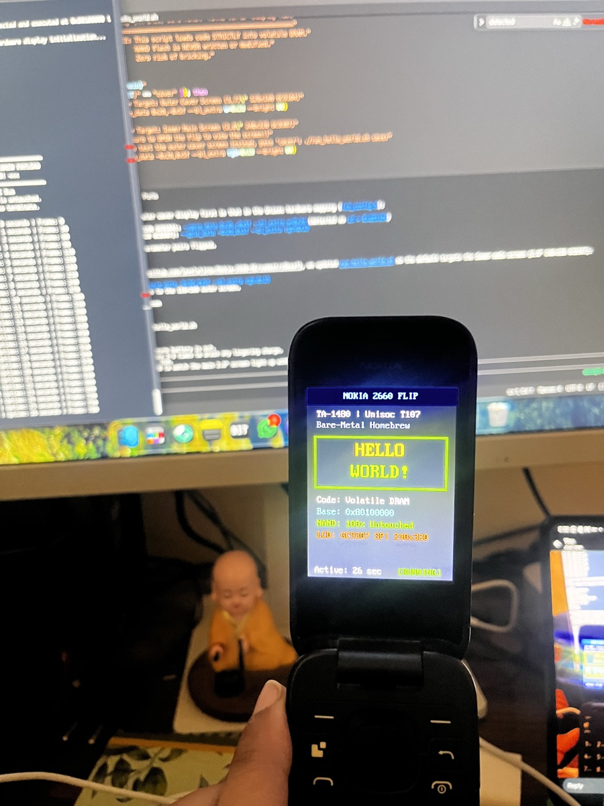

# Nokia-2660-RE

Community reverse-engineering notes for the **Nokia 2660 Flip (TA-1480)** — India series — Unisoc T107 / **UMS9117** / MOCOR feature phone.

**Goal:** understand boot + download modes, map firmware, and learn whether **custom firmware** is realistically possible. Contributions welcome — see [CONTRIBUTING.md](CONTRIBUTING.md).

## Current reference device

From dialer **`*#0000#`** on a real unit (India):

| Field | Value |
|-------|-------|
| Name | Nokia 2660 Flip |
| Type designator | TA-1480 |
| Software version | 10.02.17.00 |
| NDT code | `MH_13ARA80IN00_0` |
| HWID | **HW3.0** |
| Market | India-launched |
| Chipset / platform | Unisoc T107 / UMS9117 |
| USB (normal) | `1782:4D00` |

Full device page: [docs/device.md](docs/device.md).

**Note:** PAC / NV work here targets the **Indian** series (`MH_13ARA80IN00…`). Other countries may differ.

## Milestones

- [x] ✅ Identify device / USB / chipset
- [x] ✅ Obtain MOCOR PAC sample (NV name matches Indian NDT `MH_13ARA80IN00`)
- [x] ✅ Identify firmware format (`BP_R1.0.0` PAC)
- [x] ✅ Draft boot/download chain (FDL1 → FDL2; boot0 → boot1) — [docs/boot-process.md](docs/boot-process.md)
- [x] ✅ Version-matched TA-1480 dump (`10.02.17.00` / `MOCOR_...W22.04.6_P4_Release`) — [firmware/dumps/ta1480_10.02.17.00](firmware/dumps/ta1480_10.02.17.00)
- [x] ✅ Reverse-engineer hardware peripherals (Keypad matrix, GC9307/GC9104 SPI LCDs, PMIC SC2720 flashlight/vibrator, Audio PA)
- [x] ✅ Find application loader architecture (monolithic native C in `user.bin`; no dynamic J2ME/MRE loader) — [docs/application-layer.md](docs/application-layer.md)
- [x] ✅ Execute custom code safely (volatile DRAM payloads via FDL1; zero NAND flash writes) — [docs/custom-code-execution.md](docs/custom-code-execution.md)
- [ ] Modification of MOCOR RTOS framework (`user.bin` / `kernel.bin`)
- [ ] Untethered execution: Running custom code from NAND flash (custom bootloader / custom firmware)

<div align="center">
  <br>
  
  <p><em>Physical hardware verification: Bare-metal "Hello World" payload executing in volatile DRAM on the Nokia 2660 Flip (TA-1480) 2.8" QVGA screen.</em></p>
  <br>
</div>

## Repo map

| Path | What belongs here |
|------|-------------------|
| [`docs/`](docs/) | Human findings (device, boot, flash, USB, hardware, …) |
| [`firmware/`](firmware/) | PAC metadata + **extracted manifests** (binaries are gitignored) |
| [`tools/`](tools/) | Scripts (`extract_pac.py`, …) and bare-metal RAM payloads |
| [`ghidra/`](ghidra/) | How to import; local Ghidra DBs are gitignored |
| [`captures/`](captures/) | Guidance for USB/UART/photos |

## Quick start

```bash
git clone https://github.com/lovelytingy/Nokia-2660-RE.git
cd Nokia-2660-RE
python3 -m pip install -r requirements.txt   # optional (Capstone)

# Download the PAC (see firmware/readme.md), place as:
#   firmware/v23_update_Nokia_2660.pac
python3 tools/extract_pac.py firmware/v23_update_Nokia_2660.pac
```

Useful reading order:

1. [docs/device.md](docs/device.md) — reference phone (`*#0000#`)  
2. [docs/community-findings.md](docs/community-findings.md) — boot key, dialer codes & safe dump instructions  
3. [firmware/readme.md](firmware/readme.md) — sample hashes + extract  
4. [firmware/readme.md](firmware/readme.md) / [docs/flash-layout.md](docs/flash-layout.md)  
5. [docs/boot-process.md](docs/boot-process.md) / [docs/bootrom.md](docs/bootrom.md)  
6. [docs/keypad-matrix.md](docs/keypad-matrix.md) — hardware keypad matrix & PMIC power button decoder  
7. [docs/flashlight.md](docs/flashlight.md) — SC2720 PMIC rear torch LED (`0x40608df4`)  
8. [docs/haptics.md](docs/haptics.md) — SC2720 PMIC ERM vibration motor (`0x40608e00`)  
9. [docs/audio-subsystem.md](docs/audio-subsystem.md) — speaker PA (GPIO 31) & PMIC Line-Out / Voice Band Codec (VBC)  
10. [docs/application-layer.md](docs/application-layer.md) — MOCOR application & window architecture  
11. [docs/custom-code-execution.md](docs/custom-code-execution.md) — Bare-metal RAM payloads & homebrew execution  
12. [ghidra/readme.md](ghidra/readme.md) — load FDL/boot0 in Ghidra  

## Tools (recommended)

| Tool | Why |
|------|-----|
| Python 3 | PAC extract + triage |
| [Ghidra](https://ghidra-sre.org/) | ARM Thumb RE of loaders |
| Capstone (`requirements.txt`) | Quick disasm without Ghidra |
| binwalk (optional) | Scan larger images for embedded blobs |
| USB capture (Wireshark / usbmon) | Download-mode protocol |

```bash
# macOS examples
brew install binwalk          # optional
brew install --cask ghidra    # if not already installed
```

## Host Environment & OS Compatibility

> [!NOTE]
> **Primary Host Environment: macOS**  
> This project is actively developed and tested on **macOS** (Apple Silicon / Darwin).
>
> Please note if you are using another operating system:
> - **Script & Command Differences:** Some shell snippets, USB polling scripts, and system utilities (such as `ioreg` or `system_profiler`) are macOS-specific and will need to be adapted for Linux (e.g. `lsusb`, `udev`) or Windows (PowerShell, Device Manager).
> - **OS-Specific Tools & Drivers:**
>   - **macOS:** Uses `libusb` (`brew install libusb pkg-config`). No kernel extensions needed for BootROM mode.
>   - **Linux:** Requires `udev` rules for Spreadtrum/Unisoc vendor ID `1782` and building tools like `spreadtrum_flash` via native `make`.
>   - **Windows:** Requires Spreadtrum USB / SCI / Jungo drivers (`SciU2S` driver package) and Windows builds of utilities (e.g. `spd_dump64.exe`, ResearchDownload, or SPD Upgrade Tool).
> - **Contributions:** PRs adding or improving cross-platform compatibility for Linux and Windows are very welcome!

## Acknowledgments & Credits

This research, reverse engineering, and bare-metal hardware execution relies heavily on the work of the open-source feature phone and Unisoc/Spreadtrum research community:

* **[Ilya Kurdyukov (ilyakurdyukov)](https://github.com/ilyakurdyukov)**:
  - **[`spreadtrum_flash`](https://github.com/ilyakurdyukov/spreadtrum_flash)** (`spd_dump`): The foundational reverse-engineered download-mode protocol implementation for Spreadtrum/Unisoc SoCs, enabling BootROM handshakes, FDL loading, memory dumps, and DRAM injection. Also authored `fphelper_t117` for extracting pinmaps and keymaps from kernel dumps.
  - **[`fpdoom`](https://github.com/ilyakurdyukov/fpdoom)**: Embedded port of Doom for feature phones, providing the bare-metal hardware drivers for the Nokia 2660 Flip's GC9307/GC9104 SPI LCD controllers, SC2720 PMIC backlight current sink registers, and the USB `libc_server` bridge.
* **[id Software](https://www.idsoftware.com/)**: For open-sourcing the legendary [DOOM](https://github.com/id-Software/DOOM) engine and the shareware `doom1.wad`.
* **[Capstone Disassembly Framework](https://www.capstone-engine.org/)** ([`capstone-engine/capstone`](https://github.com/capstone-engine/capstone)): Used for automated verification and disassembly of compiled ARMv7-A bare-metal payloads.
* **[NSA Ghidra](https://ghidra-sre.org/)** ([`NationalSecurityAgency/ghidra`](https://github.com/NationalSecurityAgency/ghidra)): Instrumental for static analysis and decompilation of MOCOR RTOS binaries, bootloader stages (`boot0`/`boot1`), and kernel verification routines.
* **The Spreadtrum / Unisoc Feature Phone Homebrew Community**: For documenting chip errata, boot keys, and flash structures across the SC6531 and UMS9117 series.

## Disclaimer

**No warranty. No guarantee. We are not responsible if your device bricks.**

This project is research/education only. Flashing or modifying phones can permanently destroy them, void warranties, or cause data loss. You accept **full responsibility** for anything you do with these notes or tools.

Full text: [DISCLAIMER.md](DISCLAIMER.md).

Do not share IMEI, calibration, or personal data from NV dumps.

## License

Code and documentation in this repository are released under the [MIT License](LICENSE).

Upstream firmware remains the property of its respective owners — **do not** redistribute proprietary PAC/images in git; link + hash only.
