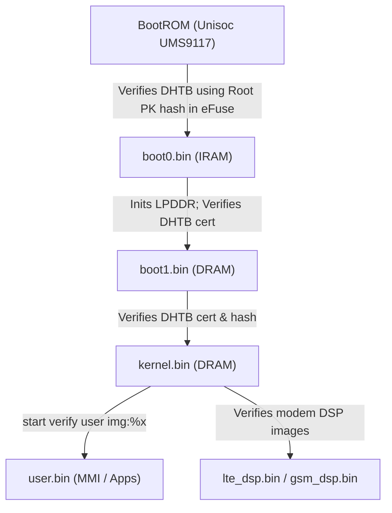

# MOCOR Application Layer & Execution Architecture

Reverse-engineering notes and static analysis of `user.bin` and the application execution model on the **Nokia 2660 Flip (TA-1480 / Unisoc T107 / UMS9117)** running software `10.02.17.00`.

---

## 1. Executive Summary: Does an App Loader Exist?

A primary goal of reverse-engineering feature phones is locating dynamic application loaders (such as Java ME MIDP/KVM `.jar` runtimes or MediaTek MRE `.vxp` environments). 

**Finding:** The Nokia 2660 Flip (and Unisoc UMS9117 MOCOR RTOS in general) **does not contain a dynamic userland application loader**:
* **No Java ME (J2ME) runtime:** `.jar` and `.jad` references in `user.bin` are strictly MIME-type table entries for WAP/MMS downloads (`application/vnd.sun.j2me.java-archive`), not an active JVM/KVM engine.
* **No MRE / VXP engine:** MediaTek's MRE application runtime is entirely absent (strings containing "MRE" are coincidental substrings like `ModemRecv` or `mrecorder`).
* **Monolithic C architecture:** Every user application (Opera Mini 4.4, Snake X, Tetris, Gameloft trial games, FM Radio, Music Player, File Manager) is written in C and statically compiled directly into `user.bin`.
* **Cryptographic signing:** `user.bin` is signed with a Spreadtrum DHTB header and verified at boot by `kernel.bin` (`start verify user img:%x`).

---

## 2. Partition & Image Profile

| Property | Dumped Hardware Image |
|----------|-----------------------|
| **Partition ID / Base** | `0x80000004` (`UserImg`) |
| **Dumped File** | `firmware/dumps/ta1480_10.02.17.00/user.bin` |
| **File Size** | 11,194,324 bytes (~10.67 MB) |
| **Header Type** | DHTB v1 (`0x42544844`), 1,172 bytes |
| **Payload Size** | 11,193,152 bytes |
| **SoC / Architecture** | ARM Cortex-A7 (ARMv7-A / Thumb-2) |
| **OS Core** | Unisoc MOCOR RTOS (proprietary RTOS over Nucleus/SCI) |
| **Build Version** | `10.02.17.00` (Compile Date: Jul 26 2021) |

---

## 3. MOCOR GUI & Application Framework (`MMK`)

MOCOR structures all interactive applications under the **MMI (Man-Machine Interface)** subsystem (`MS_MMI_Main`), managed by the **MMK (MMI Kernel / Window Manager)**:

```
+--------------------------------------------------------------+
|                       MOCOR RTOS                             |
+--------------------------------------------------------------+
|           SCI Layer (Signals, Tasks, Timers, Memory)         |
+--------------------------------------------------------------+
|            MMK (Window Manager Kernel / Event Queue)         |
+--------------------------------------------------------------+
|  Native Apps (Statically compiled C modules in user.bin)    |
|   - Opera Mini 4.4       - Snake X / Tetris                 |
|   - Audio Player         - FM Radio                         |
|   - File Manager (MMIFMM) - Camera / Video Recorder          |
+--------------------------------------------------------------+
|            MMI Resources (mmi_res.bin: Icons, Fonts, Strings)|
+--------------------------------------------------------------+
```

### Window Management Model
Each application screen is defined as a `WINDOW_TABLE` containing:
1. **Window ID:** Enum constant (e.g., `MAIN_MENU_WIN_ID`, `SNAKEX_MAIN_MENU_WIN_ID`, `OPERAMINI_MAIN_WIN_ID`).
2. **Event Callback:** Message handler processing key events (`MSG_KEYDOWN`, `MSG_KEYUP`, `MSG_APP_WEB`), timers, and focus notifications.
3. **Control Hierarchy:** Softkeys, list views, text edits, canvas areas.

Key MMK API functions identified in `user.bin`:
* `MMK_CreateWin(uint32 *win_table_ptr, ADD_DATA add_data)`: Instantiates a window.
* `MMK_CloseWin(MMI_HANDLE_T win_handle)`: Destroys a window and restores parent focus.
* `MMK_DispatchMSGKbd(...)`: Routes keypad hardware scans to active window handlers.
* `MMK_SendMsg(...)`: Asynchronous inter-thread / inter-window signaling.

---

## 4. Dissection of Built-In Applications

### 4.1 Native Opera Mini 4.4
Rather than running on a Java bytecode VM, Opera Mini is compiled as a native ARM C port:
* **Identifier:** `Native Opera Mini/4.4.34891/hifi/oem_nokia`
* **Source Tree Path (from debug symbols):**
  `MS_MMI_Main/source/mmi_app/app/operamini4/`
* **Porting Layer (`OpDev*.c`):**
  - `OpDevGDI.c`: Screen rendering onto MOCOR framebuffers.
  - `OpDevSocket.c`: Network sockets over Unisoc TCP/IP stack.
  - `OpDevFile.c`: Filesystem abstraction.
  - `OpDevMemory.c`: Dynamic heap allocations.
* **Storage Paths:**
  - `E:\OperaMiniCustom\mini4` — Local cache, saved pages, and bookmarks stored on the 32.4 MB FAT12 preload internal disk (`/Volumes/Nokia 2660F`).
  - Remote proxy endpoints: `socket://server4.operamini.com:1080` and `http://server4.operamini.com:80`.

### 4.2 Games (Snake X, Tetris, Gameloft)
All bundled games are native C implementations:
* **Snake X:** Source module `snakeX.c` (`SNAKEX_MAIN_MENU_WIN_ID`, `SNAKEX_SCOREVIEW_WIN_ID`).
* **Tetris:** Native C engine licensed from Tetris Holding (`TETRIS_MAINMENU_WIN_ID`, `TETRIS_NEW_WIN_ID`).
* **Gameloft Suite:** Trial games including Doodle Jump (`OD_GAME_DOODLE_JUMP_WIN_ID`), Crossy Road (`OD_GAME_CROSSY_ROAD_WIN_ID`), and Racing Attack (`OD_GAME_NEW_RACING_ATTACK_WIN_ID`). Assets and levels are stored under `%c:\od_game\`.

### 4.3 File Manager (`MMIFMM`)
The built-in file manager (`MMIFMM_*`) strictly filters by media MIME types:
* Audio: `.mp3`, `.amr`, `.wav`, `.aac`
* Video: `.3gp`, `.mp4`, `.avi`
* Images: `.jpg`, `.png`, `.gif`, `.bmp`
* Documents / Misc: `.txt`, `.vcf` (vCard), `.vcs` (vCalendar)
Any unknown file extension (such as `.bin`, `.elf`, `.jar`, `.vxp`) is treated as unsupported data with no execution handler.

---

## 5. Security & Verification Chain

The system enforces a multi-tier cryptographic boot chain:



Key strings from `kernel.bin`:
* `start verify user img:%x`
* `userimg size:%x`
* `verify user img malloc fail`
* `read header fail`

Because `kernel.bin` cryptographically validates `user.bin` against its DHTB certificate before executing MMI tasks, modifying `user.bin` in NAND without updating or bypassing the kernel check results in a boot failure or auto-recovery into BSL download mode.

---

## 6. Pathways for Custom Code Execution

Since no runtime dynamic loader exists, community research points to three viable strategies for executing arbitrary code:

### Pathway 1: RAM Injection via USB BootROM / BSL (Tested & Safe)
* **Mechanism:** Enter download mode (`*` key + USB) and run `spd_dump`.
* FDL1 runs in internal SRAM (`0x40000000`).
* Instead of running FDL2 or standard firmware, load an arbitrary bare-metal ARM binary into DRAM and execute:
  ```bash
  ./spd_dump keep_charge 1 \
    fdl firmware/extracted/v23_update_Nokia_2660/fdl1.bin 0x6200 \
    fdl custom_payload.bin ram 0x80000000 \
    exec 0x80000000
  ```
* **Pros:** 100% non-destructive (zero risk of bricking NAND); full access to display controller, keypad GPIOs, and memory.
* **Cons:** Requires a PC / USB connection at boot.

### Pathway 2: SD Card Secondary Bootloader (`sdboot_t117`)
* **Mechanism:** Developed by `ilyakurdyukov` and the `fpdoom` community. A small bootloader stub is placed into unused flash sectors or integrated into a custom loader.
* When a boot key is pressed at power-on, the hook reads `fpbin/fpmain.bin` from a FAT32 MicroSD card and jumps to it.
* **Pros:** Untethered execution directly from an SD card.
* **Prerequisite:** Flashing requires patched firmware or an existing write-capable loader.

### Pathway 3: Firmware Patching (`user.bin` / `kernel.bin`)
* **Mechanism:** Modify `kernel.bin` to patch the instruction following `start verify user img` (NOPing the hash verification branch) and flash a modified `user.bin` containing custom C logic or a custom window callback.
* **Pros:** Replaces stock apps (e.g., replacing one of the Gameloft demo games with a homebrew app or Doom).
* **Cons:** Requires flashing NAND; risk of soft-brick if signature bypass is incomplete.
