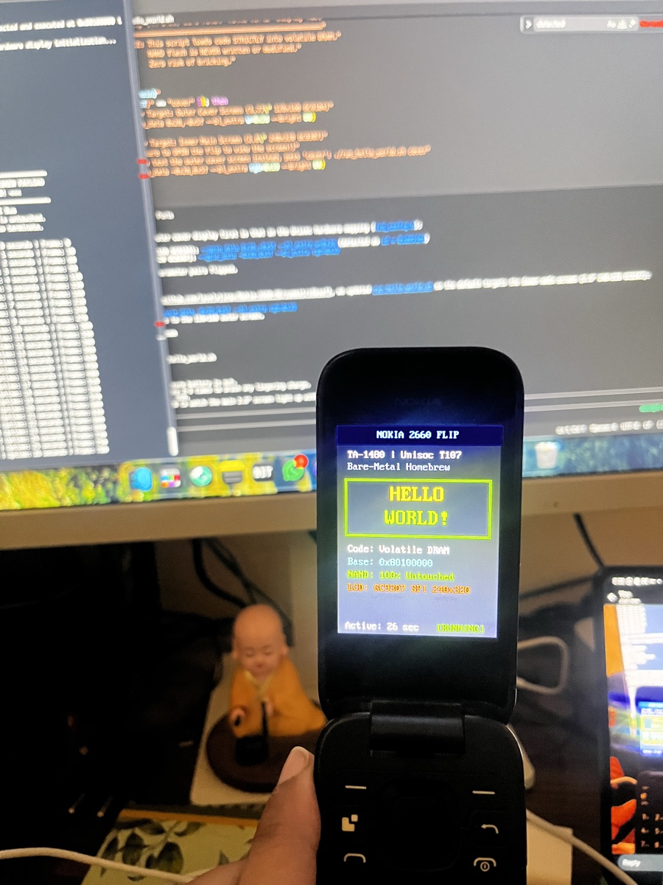

# Custom Code Execution on Nokia 2660 Flip (TA-1480)

Technical guide, toolchain, and architecture for executing custom bare-metal code safely on the **Nokia 2660 Flip (TA-1480 / Unisoc T107 / UMS9117)**.

---

## 1. Overview & Safety Guarantee

Because the Nokia 2660 Flip lacks a dynamic userland application loader (no Java ME, no MRE), running homebrew applications requires executing code on the bare-metal ARM Cortex-A7 core.

> [!IMPORTANT]
> **Zero Risk of Bricking:** The primary execution vector documented here runs **strictly in volatile DRAM** via USB download mode (BSL / FDL1).
> - NAND flash memory is **never modified or written to**.
> - The bootloader, kernel, userland partitions, and NV calibration items remain 100% factory-stock.
> - Disconnecting USB and reinserting the battery immediately returns the device to stock factory condition.

---

## 2. RAM Injection Architecture

The Unisoc UMS9117 BootROM and first-stage download loader (`FDL1`) provide a direct mechanism for injecting and executing code in RAM:

```
+-------------------------------------------------------------------------+
| Host PC (macOS / Linux)                                                 |
|   spd_dump keep_charge 1 fdl fdl1.bin 0x6200 end_data 0 fdl ram_payload.bin 0x80100000 |
+------------------------------------+------------------------------------+
                                     | USB (VID:PID 1782:4D00)
                                     v
+-------------------------------------------------------------------------+
| Step 1: BootROM Stage                                                   |
|   - Handshakes with host over USB (BSL_CMD_CHECK_BAUD, BSL_CMD_CONNECT) |
|   - Loads fdl1.bin into internal SRAM (0x40000000 / 0x6200)             |
|   - Jumps to FDL1                                                       |
+------------------------------------+------------------------------------+
                                     v
+-------------------------------------------------------------------------+
| Step 2: FDL1 Stage (DDR Initialization)                                 |
|   - Initializes LPDDR memory controller (dmc_dll_init, DDR init OK)     |
|   - Reports CHIP ID = 0x98180000 (sets ram_addr = 0x80000000)          |
|   - Receives ram_payload.bin via BSL_CMD_START_DATA / MIDST / END       |
+------------------------------------+------------------------------------+
                                     v
+-------------------------------------------------------------------------+
| Step 3: Execution Stage                                                 |
|   - Host sends BSL_CMD_EXEC_DATA (0x04)                                 |
|   - FDL1 jumps to payload entry point at 0x80000200                     |
|   - Custom ARM code executes with full hardware control!                |
+-------------------------------------------------------------------------+
```

### Entry Point & Header Convention
FDL1 expects any image downloaded for execution to feature a **512-byte (`0x200`) header**:
* **`0x000 - 0x1FF`**: DHTB Header (`44 48 54 42`, version `1`, payload length at `0x30`).
* **`0x200`**: Actual executable ARM code entry point. When `BSL_CMD_EXEC_DATA` is processed, FDL1 computes `entry = load_addr + 0x200` (`0x80000200`) and branches via `blx`.

---

## 3. The Bare-Metal Toolchain (`tools/ram_payload/`)

This repository includes a standalone build and deployment toolchain requiring no external cross-compiler toolchains on macOS:

| File | Purpose |
|------|---------|
| [`payload.S`](file:///Users/lovelytingy/Documents/Personal-Projects/Nokia-2660-RE/tools/ram_payload/src/baremetal_asm/payload.S) | ARMv7-A assembly source code demonstrating hardware control |
| [`build_payload.py`](file:///Users/lovelytingy/Documents/Personal-Projects/Nokia-2660-RE/tools/ram_payload/src/baremetal_asm/build_payload.py) | Compiles assembly with system `clang`, extracts `.text`, encapsulates DHTB header, and verifies with Capstone |
| [`run_ram_payload.sh`](file:///Users/lovelytingy/Documents/Personal-Projects/Nokia-2660-RE/tools/ram_payload/run_ram_payload.sh) | Automated runner detecting BootROM USB connection and executing payload via `spd_dump` |
| [`baremetal_asm.bin`](file:///Users/lovelytingy/Documents/Personal-Projects/Nokia-2660-RE/tools/ram_payload/bin/baremetal_asm.bin) | Compiled 616-byte binary ready for DRAM execution |

### Building the Payload
```bash
python3 tools/ram_payload/src/baremetal_asm/build_payload.py
```
Output:
```text
[+] Assembling tools/ram_payload/src/baremetal_asm/payload.S with clang...
[+] Extracted .text section: 104 bytes

[+] Disassembly of compiled payload:
    0x80100200:  push     {r4, r5, r6, r7, r8, sb, sl, fp, lr}
    0x80100204:  ldr      r0, [pc, #0x48]
    0x80100208:  ldr      r1, [pc, #0x48]
    0x8010020C:  str      r1, [r0]
    0x80100210:  ldr      r1, [pc, #0x44]
    0x80100214:  str      r1, [r0, #4]
    0x80100218:  ldr      r1, [pc, #0x40]
    0x8010021C:  str      r1, [r0, #8]
    ...
[+] Successfully built: tools/ram_payload/bin/baremetal_asm.bin
    Total Size:   616 bytes (512-byte DHTB header + 104 bytes code)
    Entry Point:  0x80100200 in DRAM
```

### Running on Hardware
```bash
./tools/ram_payload/run_ram_payload.sh
```
1. Remove phone battery and disconnect USB.
2. Hold down the **`*`** key on the keypad.
3. Plug in the USB cable to host.
4. The script detects `1782:4D00`, initializes DRAM via `fdl1.bin`, uploads `ram_payload.bin`, and triggers execution.

---

## 4. Bare-Metal "Hello World" Display Payload (`tools/ram_payload/run_hello_world.sh`)

To provide visible on-screen verification of custom code execution on the physical phone, we developed a dedicated **"Hello World"** graphical payload that combines our DRAM injection vector with `fpdoom`'s low-level hardware drivers:

### 4.1 What Was Missing in Default BootROM Mode
When code executes under BootROM / FDL1:
1. The display hardware (GC9307 SPI LCD) is powered down in hardware sleep mode.
2. The backlight LED current sink in the SC2720 PMIC is off (0V).
3. Without active SPI controller initialization and PMIC ADI register programming, the screen remains black even while code executes.

### 4.2 How the "Hello World" Engine Works
1. **DRAM Injection:** `spd_dump` injects `fdl1.bin` at `0x6200` and `hello_world.bin` at `0x80100000` with `end_data 0`.
2. **Execution Handoff:** FDL1 branches to `0x80100200`. The payload transmits an immediate BSL ACK (`0x80`) over USB, satisfying `spd_dump`.
3. **USB Serial & Display Server:** `run_hello_world.sh` seamlessly launches [`libc_server`](file:///Users/lovelytingy/Documents/Personal-Projects/Nokia-2660-RE/tools/ram_payload/bin/libc_server).
4. **Hardware Initialization:**
   - Evaluates [`pinmap.bin`](file:///Users/lovelytingy/Documents/Personal-Projects/Nokia-2660-RE/tools/ram_payload/data/pinmap.bin) and [`keymap.bin`](file:///Users/lovelytingy/Documents/Personal-Projects/Nokia-2660-RE/tools/ram_payload/data/keymap.bin) (extracted directly from TA-1480 `kernel.bin`).
   - Powers on the SC2720 PMIC backlight via ADI bus (`--bl_extra rgb=0x19`).
   - Configures the SPI interface and initializes the 240×320 GC9307 display (`--gpio_data -0x28,0x5f`).
5. **Vibrant On-Screen Rendering:**
   - Allocates an RGB565 framebuffer in DRAM.
   - Renders a midnight blue GUI, glowing pulse card, and scaled 8x16 bitmap font displaying:
     ```
     ========================
         NOKIA 2660 FLIP
      TA-1480 | Unisoc T107
     ------------------------
          HELLO WORLD!
     ------------------------
       Code: Volatile DRAM
       Base: 0x80100000
       NAND: 100% Untouched
       LCD:  GC9307 SPI 240x320
     ========================
     ```
6. **Real-time Heartbeat:** Streams live frame counts and uptime to host console over USB at 60 FPS.

### 4.3 Physical Hardware Verification

The payload was successfully deployed and verified on a physical retail Nokia 2660 Flip (TA-1480, India series, HW3.0, FW `10.02.17.00`):

<div align="center">
  <br>
  
  <p><em>Real hardware execution: The custom bare-metal ARM payload rendering the Hello World GUI on the phone's 2.8" QVGA screen via volatile DRAM.</em></p>
  <br>
</div>

### 4.4 Running the "Hello World" Display Test
```bash
./tools/ram_payload/run_hello_world.sh
```
* **Inner Main Screen (Default):** `./tools/ram_payload/run_hello_world.sh`
* **Outer Cover Screen:** `./tools/ram_payload/run_hello_world.sh cover`

---

## 5. Community Projects: `fpdoom` & `sdboot_t117`

The same RAM-injection and bootloader architecture powers high-performance community homebrew like **Doom** on the Nokia 2660 Flip:

### 4.1 Running FPDoom via USB
In the `ilyakurdyukov/fpdoom` project, the game binary (`fpdoom.bin`) is loaded into DRAM via `spd_dump`:
```bash
./spd_dump \
  keep_charge 1 \
  fdl firmware/extracted/v23_update_Nokia_2660/fdl1.bin 0x6200 \
  fdl fpdoom.bin ram
```
While running on the phone, `fpdoom.bin` bridges back to a host utility called `libc_server` over USB, which streams game data (`doom1.wad`), keymap bindings, and display controls in real-time.

### 4.2 Hardware Display & GPIO Configurations
The Nokia 2660 Flip has unique dual-screen hardware parameters identified by the community:
* **Main Inner Screen (2.8" QVGA 240×320):**
  - Display GPIO parameters: `--gpio_data -0x28,0x5f`
  - Backlight control: `--bl_extra rgb=0x19`
* **Cover Outer Screen (1.77" QQVGA 120×160):**
  - Display GPIO parameters: `--gpio_data 0x28,-0x5f`
  - Backlight control: `--bl_extra w=0x2d`

### 4.3 Untethered MicroSD Booting (`sdboot_t117`)
For untethered execution without a computer:
* A tiny secondary loader (`sdboot_t117`) is flashed into unused flash sectors.
* When holding specific keypad keys at power-on, the hook intercepts the boot chain, mounts a FAT32 MicroSD card, and executes `fpbin/fpmain.bin` according to `fpbin/config.txt`.

---

## 6. Acknowledgments & Upstream Credits

This project's bare-metal payload execution, display drivers, and USB flashing mechanisms build directly upon key community open-source repositories:

* **[Ilya Kurdyukov (ilyakurdyukov)](https://github.com/ilyakurdyukov)**:
  - **[`spreadtrum_flash`](https://github.com/ilyakurdyukov/spreadtrum_flash)** (`spd_dump`): Protocol implementation for communicating with Spreadtrum/Unisoc BootROM and FDL1 download mode, custom FDL loaders, and `fphelper_t117`.
  - **[`fpdoom`](https://github.com/ilyakurdyukov/fpdoom)**: Bare-metal feature phone drivers for GC9307/GC9104 SPI LCD panels, SC2720 PMIC backlight control, and the host-client `libc_server` communication channel.
* **[Capstone Engine](https://github.com/capstone-engine/capstone)**: ARMv7-A instruction disassembly and verification.
* **[Ghidra](https://github.com/NationalSecurityAgency/ghidra)**: Reverse-engineering the MOCOR boot chain and signature bypass vectors.

