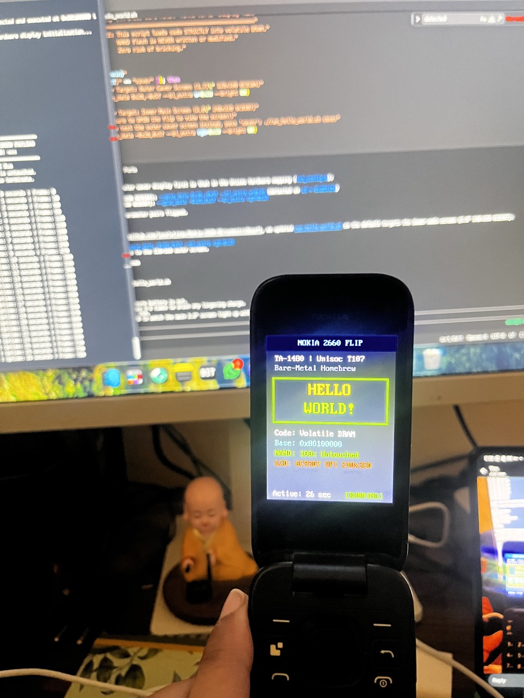

# Bare-Metal RAM Payload Toolkit

This directory contains bare-metal code execution payloads, hardware drivers, and runners for the **Nokia 2660 Flip (Model TA-1480, Unisoc UMS9117 / T107)**.

All payloads in this directory run **strictly in volatile DRAM** at `0x80100000`. NAND flash is never modified or erased, ensuring **zero risk of bricking**.

<div align="center">
  <br>
  
  <p><em>Physical hardware verification: Custom "Hello World" payload executing in volatile DRAM on the Nokia 2660 Flip (TA-1480).</em></p>
  <br>
</div>

---

## Directory Structure

```text
tools/ram_payload/
├── run_hello_world.sh          # Minimal display demo: launches visual "Hello World" card on physical LCD
├── run_keypad_test.sh          # Keypad diagnostic runner: interactive real-time keypad matrix & PMIC driver
├── run_audio_test.sh           # Audio & haptics runner: interactive speaker PA & PMIC vibrator driver
├── run_ram_payload.sh          # Minimal runner: executes 616-byte raw ARM assembly payload
├── README.md                   # This documentation
│
├── bin/                        # Precompiled binary payloads & host utilities
│   ├── hello_world.bin         # Clean graphical Hello World payload (23 KB)
│   ├── keypad_test.bin         # Interactive hardware keypad diagnostic payload (26 KB)
│   ├── audio_test.bin          # Interactive speaker PA & PMIC haptic payload (25 KB)
│   ├── baremetal_asm.bin       # Minimal 616-byte raw ARM assembly payload
│   └── libc_server             # Native macOS host USB serial / display server
│
├── data/                       # Device calibration & hardware maps (extracted from kernel.bin)
│   ├── pinmap.bin              # Unisoc T107 pin multiplexing table for TA-1480
│   └── keymap.bin              # Keypad matrix mapping table for TA-1480
│
├── src/                        # Full source code for all payloads
│   ├── hello_world/            # C clean graphical display payload
│   │   ├── hello_world_main.c  # RGB565 framebuffer, font renderer & display loop
│   │   ├── font8x16.h          # Scaled 8x16 ASCII bitmap font table
│   │   └── build.sh            # Automated compilation script (arm-none-eabi-gcc)
│   │
│   ├── keypad_test/            # C hardware keypad diagnostic tool
│   │   ├── keypad_test_main.c  # Real-time matrix event listener, coordinate & PMIC EIC decoder
│   │   ├── font8x16.h          # Scaled 8x16 ASCII bitmap font table
│   │   └── build.sh            # Automated compilation script (arm-none-eabi-gcc)
│   │
│   ├── audio_test/             # C speaker audio & PMIC haptic diagnostic tool
│   │   ├── audio_test_main.c   # GPIO 31 square-wave tones, melodies, PMIC haptic pulse & SOS
│   │   ├── font8x16.h          # Scaled 8x16 ASCII bitmap font table
│   │   └── build.sh            # Automated compilation script (arm-none-eabi-gcc)
│   │
│   └── baremetal_asm/          # Minimal ARM assembly payload
│       ├── payload.S           # Raw ARMv7-A assembly source
│       └── build_payload.py    # Python assembler & DHTB packager (native clang)
│
└── vendor/                     # Self-contained offline toolchain dependencies
    └── fpdoom/                 # Vendored fpdoom toolchain & drivers with local headers
```

---

## Quick Start: Running Payloads

### 1. Minimal "Hello World" Display Demo
Powers on the SC2720 PMIC backlight, initializes the GC9307 SPI display, and renders a clean animated "Hello World" center card with system status (volatile DRAM indicator, active uptime counter, and clean Power/End exit):

```bash
./tools/ram_payload/run_hello_world.sh
```

* To test the outer **Cover Screen (1.77")** instead of the main inner screen:
  ```bash
  ./tools/ram_payload/run_hello_world.sh cover
  ```

---

### 2. Hardware Keypad Matrix & Power Button Diagnostic Tool
Powers on the display and continuously scans both the APB Keypad Matrix (`0x40250000`) and the SC2720 PMIC EIC Power button (`0x40608280`), rendering a real-time interactive diagnostic dashboard:

```bash
./tools/ram_payload/run_keypad_test.sh
```

* **Interactive Features:**
  - Real-time detection of all physical keypad buttons (digits 0–9, `*`, `#`, D-Pad 5-way, Left/Right Selection keys, Shortcut, Back, Call, Volume Rocker, and SOS key).
  - Displays key name, hex code, physical matrix Column & Row coordinates, total event counter, and recent event history on screen.
  - Monitors SC2720 PMIC EIC Pin 1 for standalone Power / End button presses (with bug-free EIC bit isolation to prevent Key 8 crosstalk).
  - Press and hold the red **Power / End** key for ~1 second to cleanly exit.
* Supports both displays:
  ```bash
  # Inner Main Screen (2.8" 240x320)
  ./tools/ram_payload/run_keypad_test.sh

  # Outer Cover Screen (1.77" 128x160)
  ./tools/ram_payload/run_keypad_test.sh cover
  ```

For detailed register maps and key decoding formulas, see [`docs/Keypad Matrix.md`](file:///Users/lovelytingy/Documents/Personal-Projects/Nokia-2660-RE/docs/Keypad%20Matrix.md).

---

### 3. Speaker Audio & PMIC Haptics Diagnostic Tool
Initializes the external speaker Power Amplifier on **GPIO 31** (`0x40280080`, bit 15) and the SC2720 PMIC haptic motor driver (`0x40608df4`), presenting an interactive soundboard and haptics tester with a live LCD dashboard:

```bash
./tools/ram_payload/run_audio_test.sh
```

* **Interactive Controls:**
  - `[1]` / `[2]`: 440 Hz (Concert A) / 880 Hz tones
  - `[3]` / `[4]`: 1000 Hz reference beep / 2000 Hz high-frequency tone
  - `[5]`: **Iconic Nokia Ringtone** (*Gran Vals* 13-note melody)
  - `[6]`: Super Mario coin sound effect
  - `[7]`: Frequency sweep / chirp siren (300 Hz -> 2500 Hz)
  - `[8]`: Haptic tactile click (50 ms pulse)
  - `[9]`: **SOS Morse Code** emergency vibration sequence (`... --- ...`)
  - `[0]`: Heavy vibration rumble (400 ms pulse)
  - `[#]`: Super Mario theme intro jingle
  - `[*]`: Mute / stop all audio and vibration
  - `[Vol+]` / `[Vol-]`: Adjust vibrator intensity level (0 to 15) with haptic feedback tick
  - Hold **Power / End** for ~1 second to cleanly exit.
* Supports both displays:
  ```bash
  # Inner Main Screen (2.8" 240x320)
  ./tools/ram_payload/run_audio_test.sh

  # Outer Cover Screen (1.77" 128x160)
  ./tools/ram_payload/run_audio_test.sh cover
  ```

For detailed register documentation and disassembly analysis, see [`docs/Audio Subsystem.md`](file:///Users/lovelytingy/Documents/Personal-Projects/Nokia-2660-RE/docs/Audio%20Subsystem.md).

---

### 4. Minimal Bare-Metal Assembly Test
Executes a 1,000,000-cycle loop in DRAM, writes hardware marker `0x14802660` to `0x80700100`, transmits `BSL_REP_ACK` (`0x80`) over USB via FDL1's `send_ack`, and returns cleanly:

```bash
./tools/ram_payload/run_ram_payload.sh
```

---

## Connection Instructions

All payload runners follow the standard Unisoc BootROM handshake procedure:

1. Disconnect phone from USB and remove the battery.
2. Press the red **Power / End** key 2–3 times while unplugged (discharges residual capacitor charge so the PMIC detects USB cleanly).
3. Press and firmly **HOLD** the **`*`** (Asterisk) key on the keypad.
4. While holding **`*`**, plug the USB cable into the phone and computer.
5. Once detection begins, release the key and watch the console / phone screen!

---

## Rebuilding Payloads from Source

All builds run **completely offline** using the vendored toolchain in `vendor/fpdoom`. No `/tmp` or internet access is needed.

### Rebuilding "Hello World" (`hello_world.bin`)
Requires `arm-none-eabi-gcc` (install via `brew install arm-none-eabi-gcc` on macOS):
```bash
./tools/ram_payload/src/hello_world/build.sh
```

### Rebuilding Keypad Diagnostic Tool (`keypad_test.bin`)
Requires `arm-none-eabi-gcc`:
```bash
./tools/ram_payload/src/keypad_test/build.sh
```

### Rebuilding Audio & Haptics Diagnostic Tool (`audio_test.bin`)
Requires `arm-none-eabi-gcc`:
```bash
./tools/ram_payload/src/audio_test/build.sh
```

### Rebuilding Minimal Assembly (`baremetal_asm.bin`)
Uses native system `clang` (no cross-compiler needed):
```bash
python3 tools/ram_payload/src/baremetal_asm/build_payload.py
```
